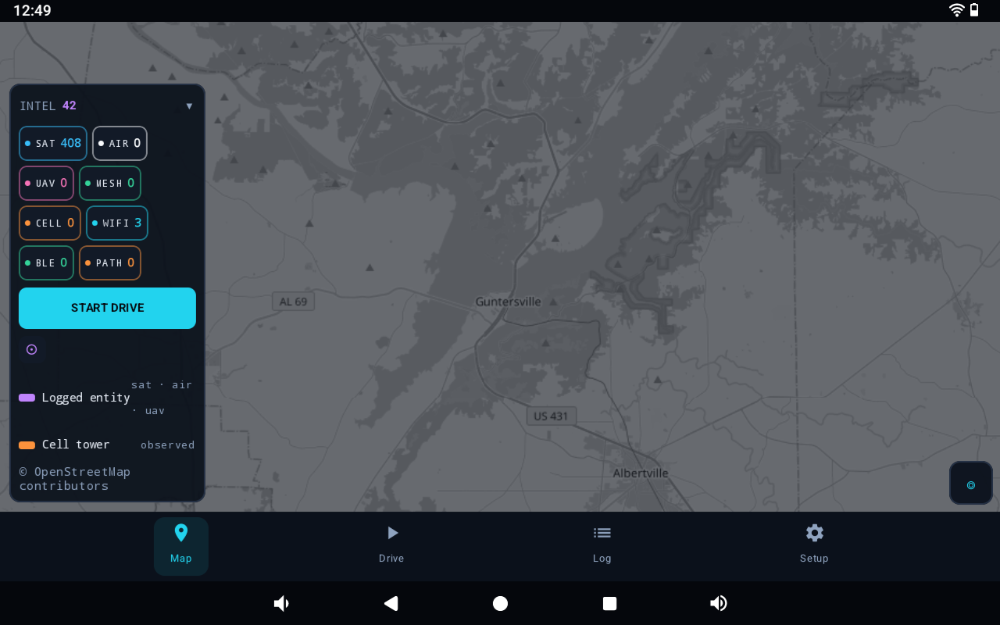
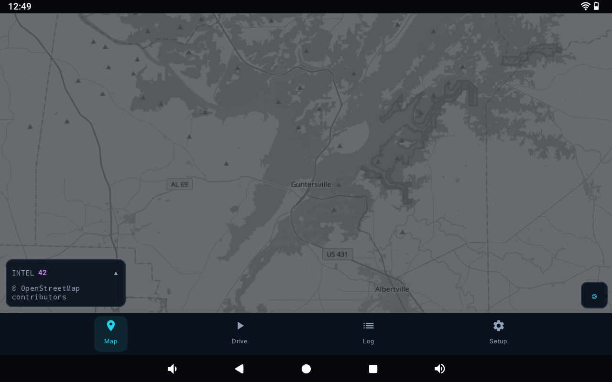
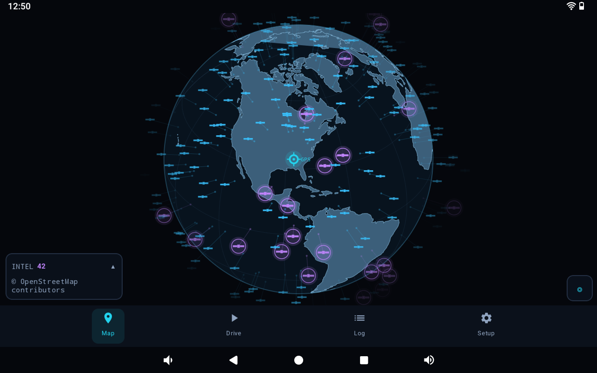
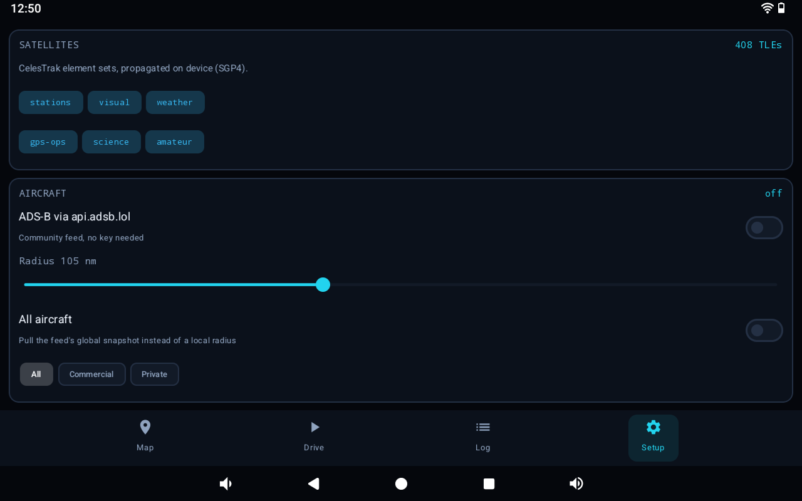
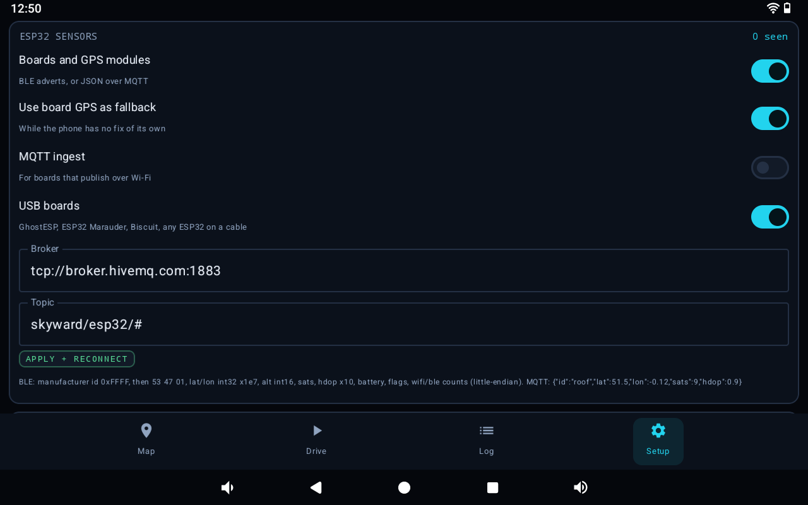

# Still in Development!

# Signal_IntelGo

**Install or update:** [download the latest APK](https://github.com/WRLS6H05T/Signal_IntelGo/releases/latest/download/Signal_IntelGo-debug.apk) - that one link always serves the newest build. It is signed with the same key as every earlier build, so Android installs it over the old one instead of demanding an uninstall.

The APK lives under [Releases](https://github.com/WRLS6H05T/Signal_IntelGo/releases) as the *Assets* of the **Latest build**, not in the file tree: it is rebuilt by CI on every push. Setup -> About shows the installed build (for example `Signal_IntelGo 1.1.11`), and the release notes name the commit it was built from, so the two can be compared.

A native Android app for live airspace + RF awareness, built around a **Wi-Fi / BLE war-driving recorder**.

One screen shows what is above you: **satellites** (SGP4), **aircraft** (ADS-B), **drones**
(ASTM F3411 Remote ID over BLE) and **mesh nodes** (Meshtastic). The recorder logs
**Wi-Fi and BLE** as you drive, and the driven path is painted on a **5-colour red → green
scale** by how strong the best signal was at each fix.

---

## Screenshots

| Map | Map, panel collapsed |
| --- | --- |
|  |  |
| Everything at once: 408 satellite element sets loaded, the INTEL chart doubling as layer switches and live counts, and a greyscale basemap that leaves RF colour as the only colour meaning anything. | The panel folds down to its count when the map matters more than the numbers. |

| Globe | Setup |
| --- | --- |
|  |  |
| Zoomed out, the map becomes the lit sphere: satellites sky blue, logged entities violet with a halo, each lifted off the ball by its own altitude and tethered to its ground point. | Every feed can be switched off: satellite groups, ADS-B radius, the all-aircraft snapshot. |

| ESP32 sensors | |
| --- | --- |
|  | |
| BLE adverts, MQTT and wired boards in one layer, with the board GPS fallback and the wire format printed under the fields. | |

---

## The colour language

Two colours systems, deliberately separate:

**1. Drive path / RF dots — signal strength (weak → strong)**

| Bin | Colour | Typical RSSI |
| --- | --- | --- |
| Very weak | `#D73027` red | < −85 dBm |
| Weak | `#F46D43` orange | −85…−75 |
| Fair | `#FDAE61` amber | −75…−65 |
| Strong | `#A6D96A` yellow-green | −65…−55 |
| Very strong | `#1A9850` green | > −55 dBm |

Each GPS fix takes the **strongest single** Wi-Fi/BLE signal heard in the last 15 s and
maps it to 0–100 (`(dBm + 95) / 55 × 100`). Segments between fixes are drawn in the bin of
the destination fix, so the path reads red where coverage was poor and green where it was hot.
The scale is RdYlGn 5-class — the same palette used on wardriving maps, so it stays legible
in daylight. Adjacent fixes are also drawn as dots at street zoom.

**2. Logged entities — violet (`#C084FC`)**

Anything captured *while recording* (or via **LOG CURRENT SKY**) is stored in a persistent
"logged" registry and drawn in violet instead of its layer colour, with a halo ring. The HUD
shows a running `LOGGED n` count, and the Log tab breaks it down per layer. This is how a
satellite or aircraft that has been logged is distinguishable at a glance from one merely
in view.

Layer colours when *not* logged: satellites sky-blue `#38BDF8`, aircraft white `#F8FAFC`,
drones pink `#F472B6`, mesh nodes green `#34D399`.

---

## Zoom behaviour

Zooming out is not just a fade: the flat map curls into a lit sphere, and the entities rise
off it by their own altitude.

| Zoom | What is drawn |
| --- | --- |
| ≥ 8.5 | everything: satellites, aircraft, drones, mesh nodes, cell towers, path |
| ≥ 4.2 | raster tiles and markers on the flat map |
| < 4.2 | sphere only: graticule, continents, every marker riding the ball, no tiles |

The globe is shaded like a lit ball: radial-gradient ocean, 15° graticule, every continent in
one hue curved by the same light, and an atmospheric rim. Anything on the far hemisphere is
dropped, so the back of the world never shows through. Drag to spin it.

**Height is drawn as height.** Every marker is put on the sphere and then pushed outward along
its radius by its altitude, with a thin tether and a ground dot back to where it really is:

| Entity | Typical altitude | Lift on the globe |
| --- | --- | --- |
| Mesh node | on the ground | none, sits on the surface |
| Drone | 120 m | barely perceptible |
| Airliner | 11 km | clearly airborne, short tether |
| LEO satellite | 400–1 200 km | well clear of the ball, long tether |
| GEO satellite | 35 786 km | capped so it stays on screen |

Altitude is compressed logarithmically — at true scale an airliner at 11 km would be 0.17 % of
Earth's radius, i.e. invisible.

Markers are flat 2-D icons, one shape per kind of thing, drawn with solid colours only (no
shaders — the whole catalogue is on screen at globe zoom):

| Marker | Icon |
| --- | --- |
| Satellite | body with two solar wings |
| Aircraft | arrow along its track |
| Mesh node | satellite dish |
| Cell tower | lattice tower with signal arcs |
| Drone | quadcopter, or a smaller arrow when it reports a heading |
| Your position | GPS reticle labelled `GPS` |

Cell towers come from `TelephonyManager` (LTE, GSM, WCDMA) and get their own `CELL` count and
toggle. Android never exposes mast coordinates, so a tower is pinned where it was first heard
and stays there: the icon marks where you heard it, not a surveyed position. Nothing about the
cellular network leaves the device.

Nothing is hidden by zoom level: every satellite and every aircraft stays on the map, and the
GPS marker stays put whenever location is on. Taps only reach entities on the near side of the
sphere, so you cannot select something drawn behind the globe.

The continent outline is Natural Earth 110m land, simplified to 0.01° and bundled as a
56 KB asset — no network, no mapping SDK.

---

## Data sources

| Layer | Source | Notes |
| --- | --- | --- |
| Satellites | CelesTrak `gp.php` element sets, propagated **on device** | Groups: stations, visual, weather, gps-ops, science, amateur. Cached 6 h on disk, so the map keeps moving offline. |
| Aircraft | `api.adsb.lol` point query around the observer | Free community feed, no API key. Radius configurable 10–250 nm. |
| Drones | BLE ASTM F3411 **Remote ID** service data (`0xFFFA`) | Parsed locally: Basic ID, Location/Vector, System (operator position). Also flags Meshtastic advertisers. |
| Mesh | Meshtastic JSON over MQTT (`ssl://mqtt.meshtastic.org:8883`) + BLE advertisers | Off by default; enable in Setup. Broker/topic/credentials are editable. |
| Wi-Fi | `WifiManager` scan table | BSSID/SSID/RSSI/channel/security. |
| BLE | `BluetoothLeScanner` (low latency) | Address/name/RSSI, plus Remote ID payloads. |

Signal modelling: aircraft scores come from a 1090 MHz link budget (60 dBm EIRP −
free-space path loss), satellites from elevation above the horizon, mesh nodes from LoRa SNR
(or BLE RSSI when only heard locally).

**Satellite timing without network data files:** Orekit's UTC scale needs an IERS
leap-second table. Instead the TLE epoch and the query time are both read as UTC wall-clock
values in the TAI scale, so leap seconds cancel in `durationFrom` and SGP4 timing stays
correct while the app ships no data files. TEME → ECEF uses IAU-82 GMST, then a WGS-84
geodetic solve; the whole chain is unit-tested against `satellite.js`.

---

## Build

Requires the Android SDK (platform 34) and a JDK 21. This machine has both:

```bash
export JAVA_HOME="$HOME/.jdks/jbr-21.0.11"
export ANDROID_HOME="$LOCALAPPDATA/Android/Sdk"

./gradlew :app:assembleDebug
adb install -r app/build/outputs/apk/debug/app-debug.apk
```

Unit tests (orbit math, Remote ID parser, colour scale, exports):

```bash
./gradlew :app:testDebugUnitTest
```

### Permissions

- **Precise location** — GPS fixes, and Android only returns Wi-Fi/BLE scan results with it.
- **Nearby Wi-Fi devices** (Android 13+) / **Bluetooth scan** (Android 12+).
- Location services must be switched on system-wide for Wi-Fi scanning to return anything.

---

## Using it

1. **Map** — the INTEL box is a bar chart, one row per category: **SAT**, **AIR**, **UAV**,
   **MESH**, **CELL**, **WIFI**, **BLE**, **PATH**. Every bar is the same colour and its
   length is the share of the largest category, so the shape of the sky is legible even when
   one count is hundreds and another is two; a zero still gets a visible sliver. Tapping a
   row shows or hides that layer, and the Wi-Fi and BLE rows switch those radios (their
   tables clear, so the count drops to 0). A switched-off row keeps its bar drawn and dims
   only its label, so "hidden" never looks like "nothing there". Tap any marker for altitude,
   range, RSSI/SNR, squawk, operator ID and so on. The `◎` button re-centres on you;
   `⊙` logs the current sky. Zooming out declutters automatically (see *Zoom behaviour*).
   `MAPS ↗` hands the current view to your phone's own map app (Google Maps and friends, via a
   `geo:` intent) whenever you want real street detail — the app's own tiles stay for the
   tactical view, so nothing is downloaded twice.
2. **Drive** — the record button starts a session. Live counters show fixes, distance,
   peak signal, distinct APs/devices, and the 5-bin histogram. The "Heard now" card carries
   its own Wi-Fi / BLE toggles next to the live radio counts; signal bars use the same
   scale as the path.
3. **Log** — saved drives with distance/peak counts; show one on the map, or export
   **GeoJSON** (track + per-fix points with `score`/`bin`) and **CSV**. The logged-entity
   registry exports too.
4. **Setup** — satellite groups, ADS-B radius, Meshtastic broker/topic, basemap
   (dark or streets, both keyless OSM), weak-dot filter, logging radius, permission status.

Basemap tiles are cached on disk, so a drive area works again offline.

---

## Known limits

- Remote ID parsing is best-effort: some broadcasters rotate payloads across advertisements,
  so a frame may carry only Basic ID or only Location. Fields are merged per BSSID as they arrive.
- Wi-Fi scanning is throttled by Android (4 scans / 2 min in the foreground); the app always
  reads the freshest table the OS will give and reports the reason when a scan is refused.
- Drone detection is BLE Remote ID only — no SDR/Wi-Fi NAN capture is implemented.
- The Meshtastic public broker is shared and rate-limited; use your own broker for serious work.
- Recording stops when the app is stopped (no foreground service yet), so the screen must stay on.
- `api.adsb.lol`, OpenSky and OSM tiles are community services — respect their rate limits.

---

## Verification performed

- `./gradlew :app:assembleDebug` → **BUILD SUCCESSFUL**, `app/build/outputs/apk/debug/app-debug.apk` (≈19 MB).
- `./gradlew :app:testDebugUnitTest` → **39 tests, 0 failures**:
  - SGP4 (Orekit) + TEME→WGS-84 matches `satellite.js` reference positions within 0.05° / 5 km at TLE epoch, +10 min, +45 min.
  - GMST matches the reference implementation; geodetic round-trip; overhead look-angle.
  - Remote ID single message, message pack, service-data extraction, garbage rejection.
  - 5-bin scale boundaries, red-at-weak / green-at-strong, dBm mapping, peak-vs-mean, GeoJSON/CSV contents.
  - Wired ESP32 boards: USB id/transport classification for GhostESP, ESP32 Marauder and Biscuit, and the
    console parser - NMEA GGA/RMC with hemisphere signs, labelled lat/lon/sats/HDOP/fix, sweep counts, a
    silent console staying unknown instead of zero, and merge across polls.
- Live feeds reachable at build time: CelesTrak HTTP 200, `api.adsb.lol` HTTP 200.

Not verified: on-device runtime behaviour (no emulator or phone attached to this machine).
Scanning, map rendering and permissions must be exercised on a real device.

---

## ESP32 sensor boards

An ESP32 on the dash is a second, independent sensor: it scans Wi-Fi and BLE itself, and with
a GPS module fitted it knows where it is. Boards reach the app two ways, merged into one
`ESP32` layer (mint green `#5BE49B`, chip icon):

**BLE, no pairing.** The board puts its telemetry in manufacturer-specific data under company
id `0xFFFF` (the reserved internal/test value), little-endian:

| bytes | field |
| --- | --- |
| 0-1 | company id `0xFFFF` |
| 2-3 | magic `53 47` ("SG") |
| 4 | version `01` |
| 5-8 | latitude x 1e7 (int32) |
| 9-12 | longitude x 1e7 (int32) |
| 13-14 | altitude metres (int16) |
| 15 | satellites in fix |
| 16 | HDOP x 10 (`0` / `255` = unknown) |
| 17 | battery % (`255` = unknown) |
| 18 | flags: 1 fix, 2 wifi count, 4 ble count, 8 moving |
| 19-20 | Wi-Fi networks in the last sweep (uint16) |
| 21-22 | BLE devices in the last sweep (uint16) |

25 bytes on air including the AD header, so it fits a legacy advertisement alongside a name.
A board with no fix sends flags without bit 0 and is drawn without a position instead of at
Null Island.

**MQTT, over Wi-Fi.** `{"id":"roof","lat":51.5,"lon":-0.12,"alt":32,"sats":9,"hdop":0.9,`
`"batt":82,"wifi":41,"ble":17,"fix":true,"fw":"1.0.3"}` on `skyward/esp32/#` (broker and
topic are editable under Setup → ESP32 sensors).

**USB, one cable.** Plug a board in and it is recognised without pairing: Espressif
native USB (`303a:1001`), CP210x (`10c4:ea60`), CH340 (`1a86:7523`) and FTDI bridges are
all opened at 115200 8N1 and asked who they are. ESP32 Marauder answers with its banner or
`@MARAUDER:{"protocol":1,...}`; GhostESP prints `GhostESP` and its verb list (`scanap`,
`bledetect`, `badble`, `karma`); Biscuit has no serial CLI at all and is identified by its
hardware signature - a Biscuit Pro/Ultra presents the C5 core and the WROOM module as two
serial ports at once. A board whose console stays quiet is still listed, as an ESP32 on the
bridge that was detected. Wired boards never age out; they leave the roster when unplugged.

Recognition is not the end of it: a wired board is polled, not just identified. Every few seconds the
port is reopened, `gps`, `scanap` and the family's BLE verb (`bledetect` on GhostESP, `blescan` on
Marauder) are sent, and the reply is parsed as NMEA or as labelled output, so a board with its own GPS
module places itself on the map and can stand in for a handset with no fix. Anything a board has not
answered yet reads as an em dash, never as a confident zero, and a bridge with no CLI is simply listened
to. The HARDWARE panel shows the live AP and BLE counts, satellite count, HDOP, the board position and
the board's last console line. What a sweep names - BSSIDs, SSIDs, RSSI, channel and BLE
advertisers - joins the same Wi-Fi and BLE tables the handset's radios fill, so a board's
networks count on the map, in the INTEL chart and in the drive record like any other
observation, and age out on the same fifteen-second window.

**GPS fallback.** While the phone has no fix of its own, a board reporting four or more
satellites stands in as the observer, so a cold handset still puts the map where you are. The
first real handset fix takes over again, and the behaviour is a switch.

## Installing and updating without a cable or an SD card

Every push to `main` builds the app on GitHub Actions and publishes it as the latest release:

    https://github.com/WRLS6H05T/Signal_IntelGo/releases/latest/download/Signal_IntelGo-debug.apk

Open that link on the phone, download it and tap the file: Android installs it over the running
app. The URL never changes, so it can be bookmarked or kept on the home screen, and the release
is replaced automatically on each push.

Builds are signed with the key committed in `keystore/signal-intelgo.jks` (settings in
`keystore.properties`) instead of a machine-specific debug key, which is what lets a GitHub
build replace a desktop build and vice versa. The first build signed this way has to replace
the old debug-signed install once - uninstall the app, install this APK, and every update is
in place from then on. The key is committed deliberately: this is a personal side-load app, and
a stable certificate is the only way in-place updates work. Anyone with access to the
repository can sign an APK that Android will accept as this app.

The workflow runs the unit tests before it builds, so a red build never becomes a download.

## WiGLE

The WiGLE panel on the Log tab uses the API in full, with the API name and token from
<https://wigle.net/account>:

| Button | WiGLE endpoint | What it does |
| --- | --- | --- |
| UPLOAD CSV | `POST /api/v2/file/upload` | sends the logged signals as WiGLE's own CSV |
| VERIFY KEY | `GET /api/v2/profile/user` | confirms the key belongs to an account |
| LIST UPLOADS | `GET /api/v2/file/transactions` | every file this account has uploaded, newest first |
| KML / SAVE ALL KML | `GET /api/v2/file/kml/{transid}` | pulls the KML of one upload, or of all of them, into `data/wigle/` |
| SEARCH MINE | `GET /api/v2/network/search`, `/bluetooth/search`, `/cell/search` with `onlymine` | searches the observations this account contributed, paged with `searchAfter` |

The KML files are written into the same folder as the rest of the data, so they are copied off the
phone with it. WiGLE grants each account a daily query allowance; the panel makes one request per
button press, and pagination is a press of its own, so the allowance is never spent on pages
nobody asked for.

## Offline map

The map draws from a tile cache that fills as you pan. The **⇩** button on the map's right-hand
stack saves the ground around the current centre for use with no network: coarse zooms first
down to the zoom you are on, a few kilometres across, capped at a few hundred tiles. It reports
`SAVE 128/377` while it runs and `OFFLINE 377 tiles` when it finishes.

Saved tiles live in the app's `files/tiles_v2`, not `cacheDir`, so Android does not evict them to
reclaim space; **CLEAR TILE CACHE** in Setup removes them. The tiles come from OpenStreetMap's
volunteer servers, which is why the save is a neighbourhood rather than a country.

## Getting around

The tab bar is not a bar. Folded away nothing is reserved at all: the screen gets its full
height and the only thing left is one square button in the bottom-right corner, the same size
and border as the map's own buttons. Tap it for Map, Drive, Log and Setup; choosing a tab folds
it away again. The map's action stack and the scrolling screens leave that corner clear, so the
button never lands on top of a control.

## Clock and weather

Setup -> **Clock** -> **Live time** puts a running clock in the map's top-right corner. Tapping
it opens the weather at the GPS pin: conditions, temperature and what it feels like, humidity,
cloud, wind and gusts, rain right now, pressure, and the terrain height at the pin - a useful
second opinion on the map's own elevation. It comes from Open-Meteo, which needs no account and
no key, and is read at most every ten minutes (and again after moving two kilometres), so the
drop-down is current without being a fetch per tap. With the clock off, nothing is drawn and the
feed is never asked.

## Units

Setup -> **Units** chooses kilometres or miles, and Celsius or Fahrenheit. Distances are still
stored and computed in kilometres - the GPS, the satellite maths and the peer frames all speak
metric - and converted only where a number is written on screen, so switching units never
rewrites a saved drive or changes what the other phone receives. Wind and rain follow the
distance unit (mph and inches with miles, km/h and millimetres with kilometres), the terrain
height follows it too, and the temperature setting applies to the weather drop-down.

## Clock

The map's clock can show seconds or not - Setup -> Clock -> **Seconds**. With seconds off, the
hour and minute are drawn larger in the same corner, which is the size that reads from a dash
mount.

## Watcher

Setup -> **Watcher** turns on hands-free voice. Say **"Watcher"** and the interface answers
without a touch: *intel report*, *open map*, *drive*, *log*, *setup*, *open menu*, *close menu*,
*start logging*, *stop logging*, *miles*, *kilometres*, *celsius*, *fahrenheit*, *mute*, *unmute*,
*sleep*. The name is accepted in the forms a recogniser actually returns - "Watcher", "Wotcher",
"Watcha", and the two words "watch her" - and a bare command works for twenty seconds after it,
so "Watcher... open setup" does not need the name twice. A small status box sits directly under
the map's clock in the top-right corner, showing whether it is listening, awake or speaking and
the last phrase heard; tap it to wake it without saying anything.

**"Watcher, intel report"** answers in two parts, in this order: the **connected devices** first -
how many Flock cameras, Axon cameras, TASERs and trackers matched, and the nearest by name - and
then the **signal intel**: Wi-Fi networks, Bluetooth devices, cell towers, mesh nodes, satellites
and aircraft in range, whether a GPS fix is held, and whether a drive is being recorded and how
far it has gone.

There are two machine voices, **WOMAN** and **MAN** - the same Watcher, Watch Dogs' ctOS, one
pitched above the engine's natural voice and one well below it. A phone's text-to-speech engine has
one voice per locale and a pitch and rate dial, so the machine is carried by the pacing instead:
commas, semicolons and dashes become full stops, and a long report is read as a list of findings,
one idea per sentence. That is the honest limit of text-to-speech, not a clone of the performance.

Whichever voice is chosen, the **glitched delivery** stays reserved for the watch list: a Flock
camera, an Axon body camera, a TASER or a tracker is announced in the broken, slowed-down version
of that voice - once per device per five minutes, so a drive does not become a monologue. Everything uses
the phone's own recogniser and text-to-speech engine: no audio is written to a file and nothing is
sent anywhere. She listens while the app is open and the screen is on; a background listener would
need a microphone foreground service and its permanent notification, which this does not add.

The microphone is requested only when the switch is turned on, not at launch.

## Watch list

Bluetooth trackers - AirTag, Tile, SmartTag, Chipolo and the like - are matched by the name they
broadcast and drawn in violet alongside the cameras. A tracker's name is the only evidence, because
the strong ones rotate their address and encrypt their payload; the Apple and Samsung manufacturer
ids raise confidence but never match on their own, or every phone in the street would be a hit.

The radios also look for surveillance hardware and pin a match where it was heard: **FLOCK**
(Flock Safety ALPR cameras, including their `FS Ext Battery` packs and `Flock-XXXX` names),
**AXON** (body cameras) and **TASER** (Axon conducted-energy devices). Each gets its own glyph
and colour, a WATCH row in the INTEL table, and a marker card that says how the match was made.

The signatures are name-based, plus the XUNTONG Bluetooth manufacturer id (`0x09C8`) that
Flock's camera and battery hardware advertises. That is a lead, not proof: a camera that keeps
its name hidden, and any device whose address rotates, is indistinguishable from an anonymous
MAC. A hit marked `name + manufacturer id` is the one to trust. A handset radio reports no
bearing, so a hit sits at the phone's own fix with a small fixed offset - "somewhere within
radio range", not a triangulated position.

## Two phones: host, globe view and scan assignments

Setup -> **Two devices** -> **Link role** overrides the screen-size split:

| Role | What it does |
| --- | --- |
| AUTO | the larger screen takes the globe, the smaller one the wardriving view |
| HOST | shows the globe and pushes its settings to every linked device |
| GLOBE VIEW | shows the globe and follows the host |

The host sends its map style, weak-dot filter, aircraft switch, satellite groups, globe spin
speed and scan assignments with every snapshot. A globe view applies them when **Follow host
settings** is on; it never pushes anything back, so the two cannot fight over the same value.

Every radio gets an assigned sweep. In the **PEER** card, and in each board's expanded **ESP32**
card, a **SCAN** drop-down picks the band; **GPS** is a separate switch because it applies to any
band. The choices follow what the device actually reports: 5 GHz is only offered on a dual-band
board (an ESP32-C5), BLE only when the firmware has shown it sweeps BLE, and GPS only when a
module has produced a fix or an HDOP. A single-band board says so instead of silently offering a
band it cannot hear. The assignment is shown in the card and in the host's **INTEL** table as
`peer scan · WI-FI 2.4+5 + GPS`.

The **MESH** card now appears only when there is at least one node; with nothing attached the
space goes back to the INTEL table.

Satellite capture is fixed at **150 km** from the observer. The old slider is gone because a
wider radius captured most of the catalogue on every tick rather than anything overhead.

## BIRDS-3

The three BIRDS-3 1U CubeSats - NepaliSat-1 (Nepal), Raavana-1 (Sri Lanka) and Uguisu (Japan) -
were deployed from the ISS on 17 June 2019 and re-entered in October 2021. The app asks CelesTrak
for their catalogue numbers on every element-set refresh and gives them the same satellite glyph
as everything else, with a gold glow when caught, but there are no live elements to propagate, so
nothing is plotted today. They appear automatically if any of them is catalogued again.

## Moving the intel to another phone

Everything the app records is plain files in one folder:

```
Internal storage/Android/data/dev.skyward.rf/files/data
```

| Folder | Contents |
| --- | --- |
| `wardrives/` | one file per drive session |
| `signals/` | the per-signal log, with the fix each signal was heard at |
| `logged/` | the registry of what has already been captured |
| `settings_v1.json` | the settings |

To move it: plug the phone into a PC, choose **File transfer** on the phone, open
`Internal storage/Android/data/dev.skyward.rf/files`, and copy the `data` folder somewhere safe.
On the new phone, install the app, open it once and close it (that creates the folder), then copy
`data` back to the same path and open the app.

Uninstalling deletes that folder along with the app, so copy it off before uninstalling. Setup ->
**Data folder** shows the exact path on the phone in front of you.
