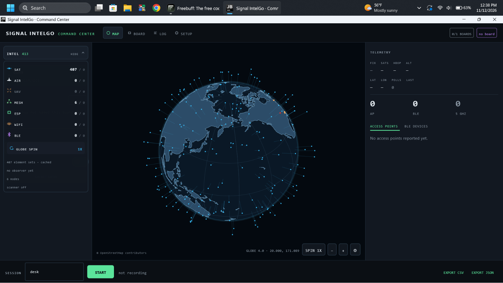

# Still in Development!

# Signal_IntelGo

**Install or update:** [download the latest APK](https://github.com/WRLS6H05T/Signal_IntelGo/releases/latest) - that page always lists the newest build, whose asset is named for its version. It is signed with the same key as every earlier build, so Android installs it over the old one instead of demanding an uninstall.

 under [Releases](https://github.com/WRLS6H05T/Signal_IntelGo/releases) as the *Assets* of the **Latest build**, not in the file tree: it is rebuilt by CI on every push. Setup -> About shows the installed build (for example `Signal_IntelGo 1.1.11`), and the release notes name the commit it was built from, so the two can be compared.

A native Android app for live airspace + RF awareness, built around a **Wi-Fi / BLE war-driving recorder**.

One screen shows what is above you: **satellites** (SGP4), **aircraft** (ADS-B), **drones**
(ASTM F3411 Remote ID over BLE) and **mesh nodes** (Meshtastic, plus **MeshCore** repeaters
from WADAMESH firmware and the MQTT observer bridges). The recorder logs
**Wi-Fi and BLE** as you drive, and the driven path is painted on a **5-colour red → green
scale** by how strong the best signal was at each fix.

---

## Screenshots

| Map | Map, panel collapsed |
| --- | --- |
|  |  |
| Everything at once: 408 satellite element sets loaded, the INTEL box doubling as layer switches, live counts and the logged entity table, and a greyscale basemap that leaves RF colour as the only colour meaning anything. | The panel folds down to its count when the map matters more than the numbers. |

| Globe | Setup |
| --- | --- |
|  |  |
| Zoomed out, the map becomes the lit sphere: satellites sky blue, logged entities violet with a halo, each lifted off the ball by its own altitude and tethered to its ground point. | Every feed can be switched off: satellite groups, ADS-B radius, the all-aircraft snapshot. |

| ESP32 sensors | |
| --- | --- |
|  | |
| BLE adverts, MQTT and wired boards in one layer, with the board GPS fallback and the wire format printed under the fields. | |

---

## The colour language

Two colours systems, deliberately separate:

**1. Drive path / RF dots — signal strength (weak → strong)**

| Bin | Colour | Typical RSSI |
| --- | --- | --- |
| Very weak | `#D73027` red | < −85 dBm |
| Weak | `#F46D43` orange | −85…−75 |
| Fair | `#FDAE61` amber | −75…−65 |
| Strong | `#A6D96A` yellow-green | −65…−55 |
| Very strong | `#1A9850` green | > −55 dBm |

Each GPS fix takes the **strongest single** Wi-Fi/BLE signal heard in the last 15 s and
maps it to 0–100 (`(dBm + 95) / 55 × 100`). Segments between fixes are drawn in the bin of
the destination fix, so the path reads red where coverage was poor and green where it was hot.
The scale is RdYlGn 5-class — the same palette used on wardriving maps, so it stays legible
in daylight. Adjacent fixes are also drawn as dots at street zoom.

**2. Logged entities — violet (`#C084FC`)**

Anything captured *while recording* (or via **LOG CURRENT SKY**) is stored in a persistent
"logged" registry and drawn in violet instead of its layer colour, with a halo ring. The HUD
shows a running `LOGGED n` count, and the Log tab breaks it down per layer. This is how a
satellite or aircraft that has been logged is distinguishable at a glance from one merely
in view.

Layer colours when *not* logged: satellites sky-blue `#38BDF8`, aircraft white `#F8FAFC`,
drones pink `#F472B6`, mesh nodes green `#34D399`, MeshCore repeaters lime `#A3E635`.

Mesh nodes that sit on the same spot - within about ten metres, which no zoom can separate -
are drawn as one dish carrying the number of nodes it stands for (`×50`). Their cards say how
many share the position. Fifty dishes on one pixel used to read as a single node while the
INTEL and Log tables counted fifty.

**Mapped cameras** are the one layer no radio hears. Flock and other ALPR plate readers, and
CCTV cameras, are read from OpenStreetMap through the Overpass API within three kilometres of
the phone, refreshed every ten minutes or after a kilometre of travel. A plate reader keeps the
camera-on-a-bracket glyph in the Flock rose, a CCTV camera gets a grey dome. Tap one for its
card - operator, vendor, housing, facing, mount, zone, distance - and, when the mapping carries
one, an **OPEN LIVE FEED** button that hands the camera's own HLS, MJPEG or web link to whatever
app can play it. The `CAM` row in INTEL switches the layer.

Volunteer mapping is a lower bound: an unmapped camera is not an absent camera, and Flock
publishes no map of its own. Camera positions are © OpenStreetMap contributors, ODbL.

**Public KiwiSDR receivers** are the other layer nothing on this phone hears. The Kiwi project
publishes a directory of HF receivers their owners have put on the internet, keyless, and the app
reads it when the `KIWI` row in INTEL is switched on - one read per half hour at most, because the
mirror that serves the list asks for a request per human action rather than a poll. The nearest
eighty are plotted as an indigo globe-under-a-mast glyph, with the antenna, advertised coverage,
user count and SNR in the card.

Tuning is a link, not a player: a Kiwi streams its spectrum and audio over its own browser
connection, so each band button opens the operator's page already tuned with Kiwi's `?f=` form
(`?f=7100lsb`). The buttons are filtered against the coverage that receiver advertises, so one
that stops at 10 MHz is never offered 15 m. Audio, waterfall and time limits belong to whoever
owns the receiver; this app only points you at it.

---

## Zoom behaviour

Zooming out is not just a fade: the flat map curls into a lit sphere, and the entities rise
off it by their own altitude.

| Zoom | What is drawn |
| --- | --- |
| ≥ 8.5 | everything: satellites, aircraft, drones, mesh nodes, cell towers, path |
| ≥ 4.2 | raster tiles and markers on the flat map |
| < 4.2 | sphere only: graticule, continents, every marker riding the ball, no tiles |

The globe is shaded like a lit ball: radial-gradient ocean, 15° graticule, every continent in
one hue curved by the same light, and an atmospheric rim. Anything on the far hemisphere is
dropped, so the back of the world never shows through. Drag to spin it.

Mesh nodes do not shrink with the zoom: on the ball a dish drawn at street weight is three pixels
on a continent, so a node there becomes a filled core in a ring over a dark backing. Without it a
green node on a green landmass read as a node that had disappeared when the map was zoomed out.

**Height is drawn as height.** Every marker is put on the sphere and then pushed outward along
its radius by its altitude, with a thin tether and a ground dot back to where it really is:

| Entity | Typical altitude | Lift on the globe |
| --- | --- | --- |
| Mesh node | on the ground | none, sits on the surface |
| Drone | 120 m | barely perceptible |
| Airliner | 11 km | clearly airborne, short tether |
| LEO satellite | 400–1 200 km | well clear of the ball, long tether |
| GEO satellite | 35 786 km | capped so it stays on screen |

Altitude is compressed logarithmically — at true scale an airliner at 11 km would be 0.17 % of
Earth's radius, i.e. invisible.

Markers are flat 2-D icons, one shape per kind of thing, drawn with solid colours only (no
shaders — the whole catalogue is on screen at globe zoom):

| Marker | Icon |
| --- | --- |
| Satellite | body with two solar wings |
| Aircraft | arrow along its track |
| Mesh node | satellite dish |
| MeshCore repeater | antenna mast with coverage arcs |
| Cell tower | lattice tower with signal arcs |
| Drone | quadcopter, or a smaller arrow when it reports a heading |
| Your position | GPS reticle labelled `GPS` |

Cell towers come from `TelephonyManager` (LTE, GSM, WCDMA) and get their own `CELL` count and
toggle. Android never exposes mast coordinates, so a tower is pinned where it was first heard
and stays there: the icon marks where you heard it, not a surveyed position. Nothing about the
cellular network leaves the device.

Nothing is hidden by zoom level: every satellite and every aircraft stays on the map, and the
GPS marker stays put whenever location is on. Taps only reach entities on the near side of the
sphere, so you cannot select something drawn behind the globe.

The continent outline is Natural Earth 110m land, simplified to 0.01° and bundled as a
56 KB asset — no network, no mapping SDK.

---

## Data sources

| Layer | Source | Notes |
| --- | --- | --- |
| Satellites | CelesTrak `gp.php` element sets, propagated **on device** | Groups: stations, visual, weather, gps-ops, science, amateur. Cached 6 h on disk, so the map keeps moving offline. The ISS is always plotted, whatever the catalogue sampling does. |
| Aircraft | `api.adsb.lol` point query around the observer | Free community feed, no API key. Radius configurable 10–250 nm. |
| Drones | BLE ASTM F3411 **Remote ID** service data (`0xFFFA`) | Parsed locally: Basic ID, Location/Vector, System (operator position). Also flags Meshtastic advertisers. |
| Mesh | Meshtastic JSON over MQTT (`ssl://mqtt.meshtastic.org:8883`) + BLE advertisers | Off by default; enable in Setup. Broker/topic/credentials are editable. |
| MeshCore | Observer MQTT bridge (`meshcore/{IATA}/{device}/packets`) | Off by default, own broker and topic in Setup. Node adverts are decoded from their hex packets: role (repeater / room server / sensor / chat) and advertised position. Only adverts are decoded — nothing is decrypted and app traffic is ignored. |
| Wi-Fi | `WifiManager` scan table | BSSID/SSID/RSSI/channel/security. |
| BLE | `BluetoothLeScanner` (low latency) | Address/name/RSSI, plus Remote ID payloads. |

**WADAMESH direct transfer.** The Transfer app on a WADAMESH device serves its files on
`http://<device>:8765/files` (its web port; some builds listen on 80 or 5000, so an address typed
without a port is probed on all three), behind a six-digit session code shown on the device. The
file list is paged: the device sends one `ENTRY` per `LIST NEXT`, as its own page does, and the
code is sent as `AUTH <code>` immediately followed by the list request — firmware that accepts the
code without announcing it would otherwise leave the app waiting out a socket timeout. Setup -> Mesh ->
*WADAMESH direct transfer* takes the address and that code, lists the screenshots, crash
reports, backups and uploads the device exposes, and pulls one to the system share sheet. The
code is minted per session and is never written to settings. The session is plain HTTP on your
own LAN, the device allows one file client at a time (a browser page will refuse the app and
vice versa), and only the paths the firmware marks readable are offered.

Signal modelling: aircraft scores come from a 1090 MHz link budget (60 dBm EIRP −
free-space path loss), satellites from elevation above the horizon, mesh nodes from LoRa SNR
(or BLE RSSI when only heard locally).

**Satellite timing without network data files:** Orekit's UTC scale needs an IERS
leap-second table. Instead the TLE epoch and the query time are both read as UTC wall-clock
values in the TAI scale, so leap seconds cancel in `durationFrom` and SGP4 timing stays
correct while the app ships no data files. TEME → ECEF uses IAU-82 GMST, then a WGS-84
geodetic solve; the whole chain is unit-tested against `satellite.js`.

---

## Build

Requires the Android SDK (platform 34) and a JDK 21. This machine has both:

```bash
export JAVA_HOME="$HOME/.jdks/jbr-21.0.11"
export ANDROID_HOME="$LOCALAPPDATA/Android/Sdk"

./gradlew :app:assembleDebug
adb install -r app/build/outputs/apk/debug/app-debug.apk
```

Unit tests (orbit math, Remote ID parser, colour scale, exports):

```bash
./gradlew :app:testDebugUnitTest
```

### Command center on the desk

`desktop/` is the same project as a host: a Compose Desktop application for the machine the
sensor boards are plugged into. It is the main console - the boards are linked here, the sweeps
are assigned here, the session is recorded here - and the phone is what you carry when you leave
the desk.



The tabs are the app's own four, with the app's own glyphs. **MAP** is the globe turning under its
own momentum (`SPIN OFF` / `1X` / `3X`, the phone's 4.5 degrees per second per step) and, zoomed
past the hand-off, OpenStreetMap street tiles: the ball's radius is derived from the same zoom as
the map's scale and the two meet where they agree on pixels per degree, so the curl into a plane
has nothing to jump. Layers are satellites propagated locally from CelesTrak element sets,
aircraft from api.adsb.lol's 30 mile ring, the Wi-Fi and BLE the desk's own boards hear at the fix
the board reported, mesh nodes from the same Meshtastic and MeshCore MQTT brokers the app reads,
and BLE Remote ID drones decoded by the app's own parser. **BOARD** is the console, **LOG** is what
the session caught, and **SETUP** holds the observer, the feeds and the satellite groups.

**INTEL** is a dropdown at the top of the sensor rail rather than a panel over the map: a header
line that opens over the boards, so switching a layer never covers the map being read. Each row
carries the app's two numbers - drawn now, and written into the session - and its own glyph.

```bash
./gradlew :desktop:run          # the window
./gradlew :desktop:test         # identity, band and session-export tests
./gradlew :desktop:packageMsi   # installer (packageDeb / packageDmg on the others)
```

| Panel | What it does |
| --- | --- |
| **INTEL** | the layer switches, opened from the header over the rail: `SAT`, `AIR`, `UAV`, `MESH`, `ESP`, `WIFI`, `BLE`, live and logged counts, the feed's own status line, and the globe spin |
| **SENSORS** | every serial port on the machine; `LINK` opens one at 115200 and keeps it open, so a board that re-enumerates does not lose its banner. The chip, firmware and family are read from the console text only, so a C3 and a C5 are never confused |
| **SCAN** | the board's assignment, as the same plan strings the app writes (`WI-FI 2.4`, `WI-FI 2.4+5`, `BLE`, `WI-FI 2.4+5 + BLE`); 5 GHz is offered only when the banner named a C5 |
| **CONSOLE** | the live transcript, a verb box and the firmware's own quick verbs (`help`, `status`, `scanap`, `blescan`, `gps`, `reboot`) |
| **TELEMETRY** | every reply parsed by the app's parser: fix, satellites, HDOP, position, altitude, and the AP and BLE tables sorted by signal on the app's red -> green scale. The **5 GHZ** count is the proof the C5's second pass ran: no single-band radio prints a 5 GHz network |
| **SESSION** | records every sighting with the board it came from and the fix that board had, then exports CSV or JSON through a native save dialog |
| **MAP** | the globe, and the INTEL table over it: SAT, AIR, ESP, WIFI and BLE, each row switching its layer. Drag to spin, `+`/`−` to size it, `◎` to reset |
| **LOG** | every recorded sighting, newest first, with the per-session counts and the same CSV/JSON exports |
| **SETUP** | the observer (a board's own fix, or a position typed in - the desk has no receiver of its own), the six CelesTrak groups, and the two feed statuses |

What goes down the cable is not chosen by the desk: the verbs come from the same
`Esp32Console.commandsFor` the handset calls, and the band menu from the same `ScanPlan`. The
parser, the plan model and the colour scale are the app's own code in `:shared`, not a copy, so a
network the desk logs is the same network the phone logs with the same fields. The desk never
flashes a board - that is still `esptool` and `firmware/build.sh`.

### Permissions

- **Precise location** — GPS fixes, and Android only returns Wi-Fi/BLE scan results with it.
- **Nearby Wi-Fi devices** (Android 13+) / **Bluetooth scan** (Android 12+).
- Location services must be switched on system-wide for Wi-Fi scanning to return anything.

---

## Using it

1. **Map** — the INTEL box is one table, drawn the same on the map and on the globe, with a row
   per category - **SAT**, **AIR**, **UAV**, **MESH**, **CELL**, **WATCH**, **CAM**, **KIWI**,
   **WIFI**, **BLE**, **SUB**, **PATH**, **SIG**, **PEER**, **ESP** - and two counts on each. **LIVE**, beside the
   label, is what is heard now, read as counts, because the screen is read for "how many" and a
   number is the honest way to say it when one category is in the hundreds and another is two.
   **LOGGED** sits at the right side of the table as its own column: what this phone has caught,
   per layer, from the sky and from every Wi-Fi network, Bluetooth device and sub-GHz hit the
   signal log holds - the same numbers as the Log tab, in the corner already being looked at.
   Tapping a row shows or hides that layer, and the Wi-Fi and BLE rows switch those radios
   (their tables clear, so the count drops to 0). A switched-off row keeps its numbers drawn and
   dims only its label, so "hidden" never looks like "nothing there". Tap any marker for altitude,
   range, RSSI/SNR, squawk, operator ID and so on. The `◎` button re-centres on you;
   `⊙` logs the current sky. Zooming out declutters automatically (see *Zoom behaviour*).
   `MAPS ↗` hands the current view to your phone's own map app (Google Maps and friends, via a
   `geo:` intent) whenever you want real street detail — the app's own tiles stay for the
   tactical view, so nothing is downloaded twice.
2. **Drive** — the record button starts a session. Live counters show fixes, distance,
   peak signal, distinct APs/devices, and the 5-bin histogram. The "Heard now" card carries
   its own Wi-Fi / BLE toggles next to the live radio counts; signal bars use the same
   scale as the path.
3. **Log** — saved drives with distance/peak counts; show one on the map, or export
   **GeoJSON** (track + per-fix points with `score`/`bin`) and **CSV**. The logged-entity
   registry exports too.
4. **Setup** — the top row arranges the screen: **MERGED** (one list, one scroll), **STACKED**
   or **SIDE BY SIDE**; then satellite groups, ADS-B radius, Meshtastic and MeshCore
   broker/topic, WADAMESH direct transfer (address + session code), basemap (dark or streets,
   both keyless OSM), weak-dot filter, logging radius, permission status.

Basemap tiles are cached on disk, so a drive area works again offline.

---

## Known limits

- Remote ID parsing is best-effort: some broadcasters rotate payloads across advertisements,
  so a frame may carry only Basic ID or only Location. Fields are merged per BSSID as they arrive.
- Wi-Fi scanning is throttled by Android (4 scans / 2 min in the foreground); the app always
  reads the freshest table the OS will give and reports the reason when a scan is refused.
- Drone detection is BLE Remote ID only — no SDR/Wi-Fi NAN capture is implemented.
- The Meshtastic public broker is shared and rate-limited; use your own broker for serious work.
- MeshCore repeaters only appear where they advertise a position. WADAMESH has a share-location
  switch and it is off by some owners: those repeaters are listed in the MESH card with their
  role and hop count, but are not pinned anywhere, because this phone's fix is not theirs.
- The MeshCore feed reads only node adverts. Positions in `neighbors` messages are relative
  signal reports, not coordinates, so they add hops rather than placement.
- Recording stops when the app is stopped (no foreground service yet), so the screen must stay on.
- `api.adsb.lol`, OpenSky and OSM tiles are community services — respect their rate limits.

---

## Verification performed

- `./gradlew :app:assembleDebug` → **BUILD SUCCESSFUL**, `app/build/outputs/apk/debug/app-debug.apk` (≈19 MB).
- `./gradlew :app:testDebugUnitTest` → **39 tests, 0 failures**:
  - SGP4 (Orekit) + TEME→WGS-84 matches `satellite.js` reference positions within 0.05° / 5 km at TLE epoch, +10 min, +45 min.
  - GMST matches the reference implementation; geodetic round-trip; overhead look-angle.
  - Remote ID single message, message pack, service-data extraction, garbage rejection.
  - 5-bin scale boundaries, red-at-weak / green-at-strong, dBm mapping, peak-vs-mean, GeoJSON/CSV contents.
  - Wired ESP32 boards: USB id/transport classification for GhostESP, ESP32 Marauder and Biscuit, and the
    console parser - NMEA GGA/RMC with hemisphere signs, labelled lat/lon/sats/HDOP/fix, sweep counts, a
    silent console staying unknown instead of zero, and merge across polls.
- Live feeds reachable at build time: CelesTrak HTTP 200, `api.adsb.lol` HTTP 200.

Not verified: on-device runtime behaviour (no emulator or phone attached to this machine).
Scanning, map rendering and permissions must be exercised on a real device.

---

## ESP32 sensor boards

An ESP32 on the dash is a second, independent sensor: it scans Wi-Fi and BLE itself, and with
a GPS module fitted it knows where it is. Boards reach the app two ways, merged into one
`ESP32` layer (mint green `#5BE49B`, chip icon):

**BLE, no pairing.** The board puts its telemetry in manufacturer-specific data under company
id `0xFFFF` (the reserved internal/test value), little-endian:

| bytes | field |
| --- | --- |
| 0-1 | company id `0xFFFF` |
| 2-3 | magic `53 47` ("SG") |
| 4 | version `01` |
| 5-8 | latitude x 1e7 (int32) |
| 9-12 | longitude x 1e7 (int32) |
| 13-14 | altitude metres (int16) |
| 15 | satellites in fix |
| 16 | HDOP x 10 (`0` / `255` = unknown) |
| 17 | battery % (`255` = unknown) |
| 18 | flags: 1 fix, 2 wifi count, 4 ble count, 8 moving |
| 19-20 | Wi-Fi networks in the last sweep (uint16) |
| 21-22 | BLE devices in the last sweep (uint16) |

25 bytes on air including the AD header, so it fits a legacy advertisement alongside a name.
A board with no fix sends flags without bit 0 and is drawn without a position instead of at
Null Island.

**MQTT, over Wi-Fi.** `{"id":"roof","lat":51.5,"lon":-0.12,"alt":32,"sats":9,"hdop":0.9,`
`"batt":82,"wifi":41,"ble":17,"fix":true,"fw":"1.0.3"}` on `skyward/esp32/#` (broker and
topic are editable under Setup → ESP32 sensors).

**USB, one cable.** Plug a board in and it is recognised without pairing: Espressif
native USB (`303a:1001`), CP210x (`10c4:ea60`), CH340 (`1a86:7523`) and FTDI bridges are
all opened at 115200 8N1 and asked who they are. ESP32 Marauder answers with its banner or
`@MARAUDER:{"protocol":1,...}`; GhostESP prints `GhostESP` and its verb list (`scanap`,
`bledetect`, `badble`, `karma`); Biscuit has no serial CLI at all and is identified by its
hardware signature - a Biscuit Pro/Ultra presents the C5 core and the WROOM module as two
serial ports at once. A board whose console stays quiet is still listed, as an ESP32 on the
bridge that was detected. Wired boards never age out; they leave the roster when unplugged.

Recognition is not the end of it: a wired board is polled, not just identified. Every few seconds the
port is reopened, `gps`, `scanap` and the family's BLE verb (`bledetect` on GhostESP, `blescan` on
Marauder) are sent, and the reply is parsed as NMEA or as labelled output, so a board with its own GPS
module places itself on the map and can stand in for a handset with no fix. Anything a board has not
answered yet reads as an em dash, never as a confident zero, and a bridge with no CLI is simply listened
to. The HARDWARE panel shows the live AP and BLE counts, satellite count, HDOP, the board position and
the board's last console line. What a sweep names - BSSIDs, SSIDs, RSSI, channel and BLE
advertisers - joins the same Wi-Fi and BLE tables the handset's radios fill, so a board's
networks count on the map, in the INTEL table and in the drive record like any other
observation, and age out on the same fifteen-second window.

**GPS fallback.** While the phone has no fix of its own, a board reporting four or more
satellites stands in as the observer, so a cold handset still puts the map where you are. The
first real handset fix takes over again, and the behaviour is a switch.

## Installing and updating without a cable or an SD card

Each build is published as its own release with its own file name - `Signal_IntelGo-1.1.57.apk`,
then `Signal_IntelGo-1.1.58.apk`, and so on. That is deliberate: one fixed file name per build
means the asset is deleted and re-uploaded on every push, and a download that overlaps a build
then resumes against a file that no longer exists, which is what leaves the phone stuck on the
last megabyte of a download it can never open. Take the APK from the newest release on the page
and the transfer always matches the file. A download that is already stuck will not recover:
cancel it in the browser downloads list before starting the new one.

Every push to `main` builds the app on GitHub Actions and publishes it as the latest release:

    https://github.com/WRLS6H05T/Signal_IntelGo/releases/latest

Open that link on the phone, download it and tap the file: Android installs it over the running
app. The page link never changes, so it can be bookmarked or kept on the home screen, and the
is replaced automatically on each push.

Builds are signed with the key committed in `keystore/signal-intelgo.jks` (settings in
`keystore.properties`) instead of a machine-specific debug key, which is what lets a GitHub
build replace whatever is already installed. The first build signed this way has to replace
the old debug-signed install once - uninstall the app, install this APK, and every update is
in place from then on. The key is committed deliberately: this is a personal side-load app, and
a stable certificate is the only way in-place updates work. Anyone with access to the
repository can sign an APK that Android will accept as this app.

The workflow runs the unit tests before it builds, so a red build never becomes a download.

## WiGLE

The WiGLE panel on the Log tab uses the API in full, with the API name and token from
<https://wigle.net/account>:

| Button | WiGLE endpoint | What it does |
| --- | --- | --- |
| UPLOAD CSV | `POST /api/v2/file/upload` | sends the logged signals as WiGLE's own CSV |
| VERIFY KEY | `GET /api/v2/profile/user` | confirms the key belongs to an account |
| LIST UPLOADS | `GET /api/v2/file/transactions` | every file this account has uploaded, newest first |
| KML / SAVE ALL KML | `GET /api/v2/file/kml/{transid}` | pulls the KML of one upload, or of all of them, into `data/wigle/` |
| SEARCH MINE | `GET /api/v2/network/search`, `/bluetooth/search`, `/cell/search` with `onlymine` | searches the observations this account contributed, paged with `searchAfter` |

The KML files are written into the same folder as the rest of the data, so they are copied off the
phone with it. WiGLE grants each account a daily query allowance; the panel makes one request per
button press, and pagination is a press of its own, so the allowance is never spent on pages
nobody asked for.

## Offline map

The map draws from a tile cache that fills as you pan. The **⇩** button on the map's right-hand
stack saves the ground around the current centre for use with no network: coarse zooms first
down to the zoom you are on, a few kilometres across, capped at a few hundred tiles. It reports
`SAVE 128/377` while it runs and `OFFLINE 377 tiles` when it finishes.

Saved tiles live in the app's `files/tiles_v2`, not `cacheDir`, so Android does not evict them to
reclaim space; **CLEAR TILE CACHE** in Setup removes them. The tiles come from OpenStreetMap's
volunteer servers, which is why the save is a neighbourhood rather than a country.

### Offline mode

Setup -> **Offline** is the switch for when there is no network at all. With it on, the globe and
the map draw the **GPS constellation and nothing else**: no aircraft, drones, mesh nodes, cell
towers, ESP32 boards, watch hits, logged signals or drive path. The element sets are the ones
already cached and the basemap is the tiles already saved, so nothing is downloaded and no feed
is polled - the aircraft, mesh, peer and weather clients are stopped when it goes on and started
again when it goes off. The phone's own GPS keeps running, because the receiver is local.

Only the GPS satellites are drawn, recognised by catalogue name (`GPS BIIR-2 (PRN 13)`,
`NAVSTAR 71` and the rest of the gps-ops group), because the cache stores element sets rather
than the group each one came from. The sky is only as full as that cache: with nothing saved,
offline mode shows no satellites until it is switched off once with a connection. The INTEL
header carries an `OFFLINE` flag so an empty layer is not mistaken for a dead feed, and the
map's **⇩** save button is hidden while it is on, since saving tiles is a download.

## Getting around

The tab bar is not a bar. Folded away nothing is reserved at all: the screen gets its full
height and the only thing left is one square button in the bottom-right corner, the same size
and border as the map's own buttons. Tap it for Map, Drive, Log and Setup; choosing a tab folds
it away again. The map's action stack and the scrolling screens leave that corner clear, so the
button never lands on top of a control.

## Clock and weather

Setup -> **Clock** -> **Live time** puts a running clock in the map's top-right corner. Tapping
it opens the weather at the GPS pin: conditions, temperature and what it feels like, humidity,
cloud, wind and gusts, rain right now, pressure, and the terrain height at the pin - a useful
second opinion on the map's own elevation. It comes from Open-Meteo, which needs no account and
no key, and is read at most every ten minutes (and again after moving two kilometres), so the
drop-down is current without being a fetch per tap. With the clock off, nothing is drawn and the
feed is never asked.

## Units

Setup -> **Units** chooses kilometres or miles, and Celsius or Fahrenheit. Distances are still
stored and computed in kilometres - the GPS, the satellite maths and the peer frames all speak
metric - and converted only where a number is written on screen, so switching units never
rewrites a saved drive or changes what the other phone receives. Wind and rain follow the
distance unit (mph and inches with miles, km/h and millimetres with kilometres), the terrain
height follows it too, and the temperature setting applies to the weather drop-down.

## Clock

The map's clock can show seconds or not - Setup -> Clock -> **Seconds**. With seconds off, the
hour and minute are drawn larger in the same corner, which is the size that reads from a dash
mount.

## Watcher

Setup -> **Watcher** turns on the voice. It listens **only between a tap on the status box and the
end of the command that follows**: nothing holds the microphone on between taps, so there is no
wake-word loop and no battery cost while driving. The box sits directly under the map's clock in
the top-right corner and shows the state - *tap to talk*, *listening*, *speaking* - and the last
phrase heard; the first tap also asks for the microphone if it has not been granted.

Tap, then say *intel report*, *open map*, *drive*, *log*, *setup*, *open menu*, *close menu*,
*start logging*, *stop logging*, *miles*, *kilometres*, *celsius*, *fahrenheit*, *mute*, *unmute*,
*sleep*. The name **"Watcher"** can be said first but is not needed; when it is said, the forms a
recogniser actually returns are accepted - "Watcher", "Wotcher", "Watcha", and the two words
"watch her".

**"Watcher, intel report"** opens as a call and answers in three parts, in this order: the
**connected devices** first - how many Flock cameras, Axon cameras, TASERs, patrol-car routers,
radio access points and trackers matched, and the nearest by name - then the **signal intel**:
Wi-Fi networks, Bluetooth devices, cell towers, mesh nodes, satellites and aircraft in range and
whether a GPS fix is held, and finally the **logged entities** the Log tab is counting -
satellites, aircraft, drones, mesh nodes, cell towers, ESP32 boards, watch hits, Wi-Fi networks
and Bluetooth devices. It closes on *Watcher out*. Whether recording is armed is not part of it:
what has been collected is the report, and "logging is off" three words before the sign-off was
heard as a second goodbye.

### Sub-GHz behind an ESP32

A wired GhostESP or ESP32 Marauder with a CC1101 fitted hears the bands the phone's radios
cannot. When the board's own console mentions the module (`cc1101`, `subghz`) the hardware card
says `Sub-GHz · CC1101`, and with the Setup switch on, the poll appends one configured command
to its sweep cycle - `subghz rx` by default, because the verb differs between firmware builds.

What comes back is parsed off the same transcript: a line needs both a carrier frequency in
300-928 MHz and a level, so a help text that merely lists the band adds nothing. Each carrier
is logged as one entity, keyed by frequency and keeping its strongest hearing, then drawn on
the map where the board was listening, counted in the Log tab as **Sub-GHz hits**, and read out
last in the Watcher's intel report. Carriers stay out of the WiGLE export: WiGLE wants a MAC,
an SSID and a channel, and a keyfob has none of the three.

### RTL-SDR

With the Setup switch on, plugging in an RTL-SDR (Realtek `0bda:2832`, or `0bda:2838` with an
R820T/R828D tuner) drops a spectrum panel open at the top centre of the map; it folds back to a
pill, and is not drawn at all when no dongle is attached or the switch is off. The panel shows
the live trace with its peak, the tuned centre and span, preset bands (100/145/315/433.92/868/915
MHz), and **REC** / **STOP · SAVE**.

Stopping saves the capture: the averaged trace plus a waterfall strip, the centre, span, peak,
length and the fix it started on. The capture is pinned on the map as a small pennant and stays
there - tapping it opens the trace again without the dongle, which is why the spectrum is what is
stored rather than the raw I/Q. Captures live in `sdr/sdr_v1.json` beside the rest of the data.

The dongle is detected, opened and read as an I/Q pipe; programming the tuner (demod init and
the R820T/R828D PLL) is not implemented, so on real hardware the panel reports that it is waiting
for I/Q instead of drawing an invented spectrum.

### Timed intel updates

Setup -> **Intel updates** has a switch, the interval - **3, 5, 7, 10 or 30 minutes**, the switch
off for never - and **WATCHER READS**: **INTEL**, **ENTITIES** or **BOTH**. **INTEL** is the live
table: the connected devices, the radios' counts and the fix. **ENTITIES** is the entity table:
what has been caught, per layer - satellites, aircraft, drones, mesh nodes, cell towers, ESP32
boards, watch matches, Wi-Fi, Bluetooth and sub-GHz hits. **BOTH** reads them in that order, which
is the default. The same choice decides what the report asked for by voice reads, so the two never
describe different tables. Each transmission opens as a call - *Watcher to operator,
intel update* - then reads the chosen tables, the GPS fix and whether a drive is running. It then
reads the **alert sightings**: how many watch hits appeared since the last update
and the three strongest of them, by family and signal strength. It closes on *Watcher out*, like
every other transmission, with the squelch either side and the tone from the same radio. The
interval is read again at the end of each wait, so moving it in Setup takes effect without a
restart; on a linked pair the larger screen's phone speaks, so the same report is not read out
twice.

There are two machine voices, **WOMAN** and **MAN** - the same Watcher, Watch Dogs' ctOS, one
pitched above the engine's natural voice and one well below it. A phone's text-to-speech engine has
one voice per locale and a pitch and rate dial, so the machine is carried by the pacing instead:
commas, semicolons and dashes become full stops, and a long report is read as a list of findings,
one idea per sentence. That is the honest limit of text-to-speech, not a clone of the performance.

Whichever voice is chosen, the **glitched delivery** stays reserved for the watch list: a Flock
camera, an Axon body camera, a TASER, a patrol-car router, a radio's access point or a tracker is
announced in the broken, slowed-down version
of that voice - once per device per five minutes, so a drive does not become a monologue. Everything uses
the phone's own recogniser and text-to-speech engine: no audio is written to a file and nothing is
sent anywhere. She listens while the app is open and the screen is on; a background listener would
need a microphone foreground service and its permanent notification, which this does not add.

The microphone is requested only when the switch is turned on, not at launch.

## Watch list

Bluetooth trackers - AirTag, Tile, SmartTag, Chipolo and the like - are matched by the name they
broadcast and drawn in violet alongside the cameras. A tracker's name is the only evidence, because
the strong ones rotate their address and encrypt their payload; the Apple and Samsung manufacturer
ids raise confidence but never match on their own, or every phone in the street would be a hit.

The radios also look for surveillance hardware and pin a match where it was heard: **FLOCK**
(Flock Safety ALPR cameras, including their `FS Ext Battery` packs and `Flock-XXXX` names),
**AXON** (body cameras), **TASER** (Axon conducted-energy devices), **ROUTER** and **RADIO**.
Each gets its own glyph and colour, a WATCH row in the INTEL table, and a marker card that says
how the match was made.

**ROUTER** is the car itself: the mobile router a patrol car carries - Cradlepoint, Sierra
Wireless AirLink, WatchGuard, a rugged Toughbook or Getac acting as the MDT - or the department's
own naming, `PD-MDT-7`, `SHERIFF 12`, `MOBILE-NET`. A vendor token marks the hit `router vendor
name` and is the one to trust; a name that only says *police* is `name only`, because anybody can
type SHERIFF into an SSID field.

**RADIO** is the access point a Motorola MOTOTRBO or APX radio raises for programming, matched on
`MOTOTRBO`, `TRBO-` or `APX-`. It is a radio, not a router, so it is announced as one.

The signatures are name-based, plus the XUNTONG Bluetooth manufacturer id (`0x09C8`) that
Flock's camera and battery hardware advertises. That is a lead, not proof: a camera that keeps
its name hidden, and any device whose address rotates, is indistinguishable from an anonymous
MAC. A hit marked `name + manufacturer id` is the one to trust. A handset radio reports no
bearing, so a hit sits at the phone's own fix with a small fixed offset - "somewhere within
radio range", not a triangulated position.

## Two phones, one picture: peer to peer

Setup -> **Two devices** links the phones over BLE. There is no host and no follower, and neither
phone assigns the other a sweep or rewrites its settings: the screen-size split alone decides that
the larger screen shows the globe and the smaller one the wardriving view.

**Sharing with** says whose phone is on the other end. **MY OWN DEVICES** shares everything below;
**A FRIEND** shares the radios, the fix, the board intel and the entity table both ways, and keeps
the drive library, the shared drive recording and forwarded Watcher commands on your own devices.

Six things travel, the same way in both directions:

| What | Why |
| --- | --- |
| Wi-Fi and BLE sweeps | each phone's own radios, merged into both tables at the fix they were heard |
| the GPS fix | the other phone's position while this one has none |
| board intel | an ESP32 on one phone's cable is a radio on both |
| logged entities | satellites, aircraft, drones, mesh nodes and watch hits, drawn cyan as the peer's catch |
| drives | a drive started on either phone is recorded by both, and a finished one can be fetched |
| Watcher commands | a command said to either phone is obeyed by both |

The **PEER** card names the other phone, its screen role, its Wi-Fi/BLE totals, its GPS and
cellular state, its board and whether it is recording, and how many entities it has shared. Its
catches join the map and the globe in the layer they belong to, coloured cyan and labelled
`shared by the linked phone`, so the card never claims them as this phone's own.

A board's sweep is the one thing still assigned by hand: in each board's expanded **ESP32** card a
**SCAN** drop-down picks the band, and **GPS** is a separate switch because it applies to any band.
The choices follow what the board reports: 5 GHz is only offered on dual-band silicon (an
ESP32-C5), BLE only when the firmware has shown it sweeps BLE, and GPS only when a module has
produced a fix or an HDOP. A single-band board says so instead of silently offering a band it
cannot hear.

The **MESH** card now appears only when there is at least one node; with nothing attached the
space goes back to the INTEL table.

Satellite capture is fixed at **150 km** from the observer. The old slider is gone because a
wider radius captured most of the catalogue on every tick rather than anything overhead.

## BIRDS-3

The three BIRDS-3 1U CubeSats - NepaliSat-1 (Nepal), Raavana-1 (Sri Lanka) and Uguisu (Japan) -
were deployed from the ISS on 17 June 2019 and re-entered in October 2021. The app asks CelesTrak
for their catalogue numbers on every element-set refresh and gives them the same satellite glyph
as everything else, with a gold glow when caught, but there are no live elements to propagate, so
nothing is plotted today. They appear automatically if any of them is catalogued again.

## Moving the intel to another phone

Everything the app records is plain files in one folder:

```
Internal storage/Android/data/dev.skyward.rf/files/data
```

| Folder | Contents |
| --- | --- |
| `wardrives/` | one file per drive session |
| `signals/` | the per-signal log, with the fix each signal was heard at |
| `logged/` | the registry of what has already been captured |
| `settings_v1.json` | the settings |

To move it: plug the phone into a PC, choose **File transfer** on the phone, open
`Internal storage/Android/data/dev.skyward.rf/files`, and copy the `data` folder somewhere safe.
On the new phone, install the app, open it once and close it (that creates the folder), then copy
`data` back to the same path and open the app.

Uninstalling deletes that folder along with the app, so copy it off before uninstalling. Setup ->
**Data folder** shows the exact path on the phone in front of you.

---

## Sensor firmware

`firmware/SignalSensor` is the sensor firmware for the two mini boards this project targets,
**ESP32-C3 Mini** and **ESP32-C5 Mini**. One ESP-IDF project, both chips, compiled per target:

```
firmware/build.sh          # both images
firmware/build.sh c3       # one of them
```

It needs an ESP-IDF checkout on `IDF_PATH` with `export.sh` sourced, so `idf.py` is on `PATH`. The
project uses `firmware/SignalSensor/partitions.csv` - one 3 MB factory app, because Wi-Fi, BLE and
GPS do not fit the default 1.2 MB OTA slot and updates arrive over the cable - and
`idf.py merge-bin` produces the image, which already places the bootloader at the offset the chip
wants (`0x0` on the C3, `0x2000` on the C5), the partition table at `0x8000` and the application
at `0x10000`. The script writes `firmware/out/esp32c3.bin`, `esp32c5.bin` and a `firmware.json`
manifest. `.github/workflows/firmware.yml` does the same in CI and uploads the two images.

It was an Arduino sketch, and the port is about the radio: the wrapper only ever scanned the band
it happened to leave the radio in, so a C5 never reported 5 GHz. Under IDF the band is selected
with `esp_wifi_set_band_mode()` between two scans and BLE runs on NimBLE, so the advertisement
payload and the scan window are the numbers written in the firmware. The sketch is kept in
`firmware/SignalSensor/arduino/` as the reference for the wire format and is no longer built.

The app neither bundles nor writes these images: a board arrives already running **Marauder** or
**GhostESP**, and that is what the app talks to. These are for a bare board that has neither, and
one command puts one on it from a PC:

```
esptool --chip esp32c5 -p /dev/ttyACM0 write-flash 0x0 firmware/out/esp32c5.bin
```

What the firmware does, on the same wire format the app already decodes:

- advertises the telemetry as manufacturer data (company id `0xFFFF`, magic `SG`), refreshed
  every two seconds, with the fix flag only set once the GPS has one;
- sweeps Wi-Fi and BLE every thirty seconds, printing the lines the app's console
  parser reads (address, RSSI, channel, SSID) so a board's networks join the same tables;
- on an **ESP32-C5** sweeps **both** Wi-Fi bands: one pass with the radio in 2.4 GHz and one in
  5 GHz, because a scan only covers the band the radio is currently in. 5 GHz networks arrive
  with their own channel numbers (36 and up). The advertisement is parked for those two passes,
  because a 5 GHz scan start is refused while BLE is advertising. A C3 has no 5 GHz radio, so
  the band code is compiled out and it sweeps 2.4 GHz only, as before;
- reads NMEA on the GPS pin and prints `APs found:`, `BLE devices:`, `GPS: fix 3D, Sats:`,
  `HDOP:`, `Lat:`, `Lon:` and `Alt:` in the shapes `Esp32Console` parses.

**GPS pin and baud are set from the app.** On the board's console:

```
gpspin 4
gpsbaud 9600
```

Both are written to NVS, so a board keeps its wiring across a reflash of the cable, and both are
also reachable as fields in the terminal panel. The firmware rejects pins that would break the
console on a mini board (the native USB pads) rather than accepting a typo silently.

### Setup -> ESP32 sensors -> SERIAL

One panel, over the USB connection the app already uses to identify boards:

- **CONNECT** takes the port away from the telemetry poller and opens it as a raw console -
  `help`, `status`, `scan`, `gpspin <n>`, `gpsbaud <n>`, `save`, `reboot`, plus anything else the
  firmware might understand. The poller resumes when the session closes.
- **RESET** pulses EN so a board that was already running reprints its boot log; a board on
  its own USB peripheral drops off the bus and is reopened automatically.

Firmware is not written from the app. A board arrives already running **Marauder** or
**GhostESP**, and the panel speaks that firmware's own commands; nothing is erased, flashed
or replaced over the cable.

---
